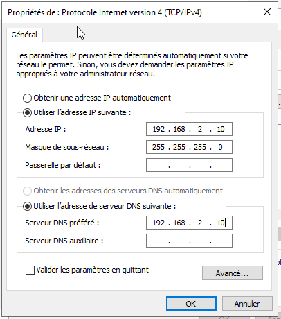
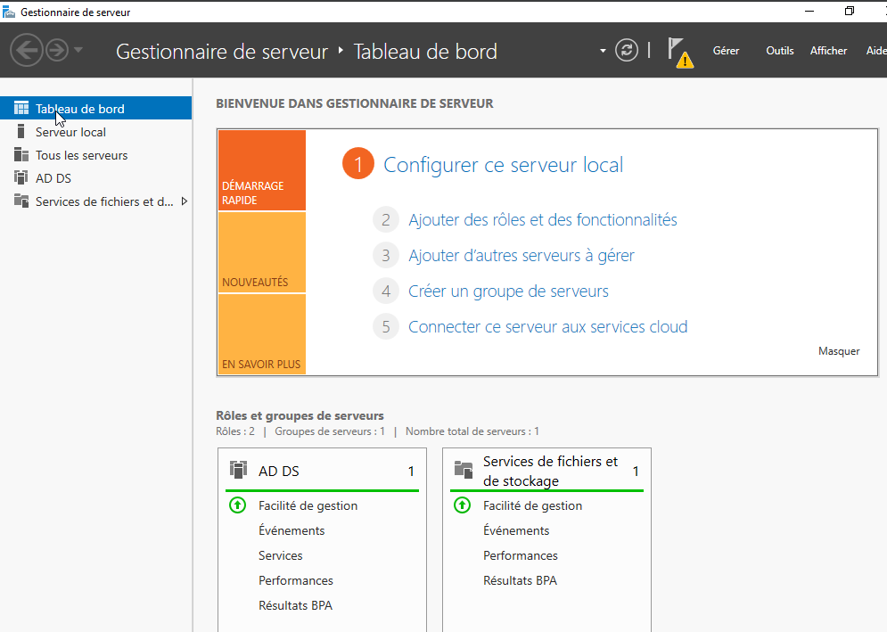
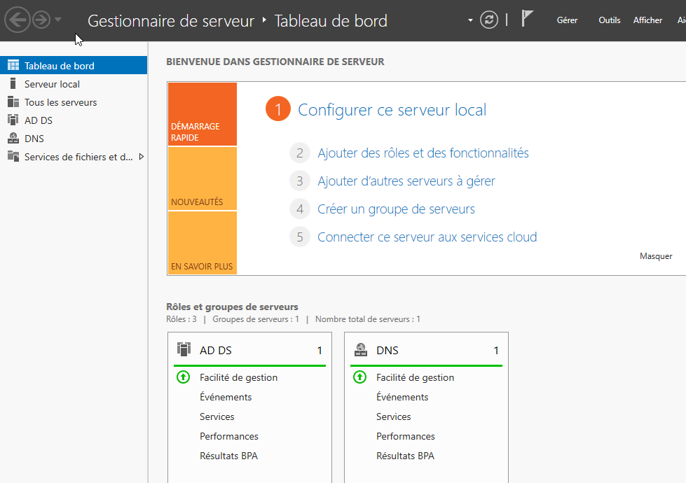
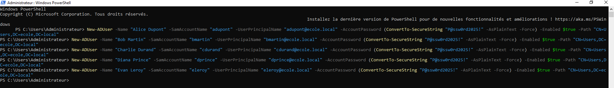
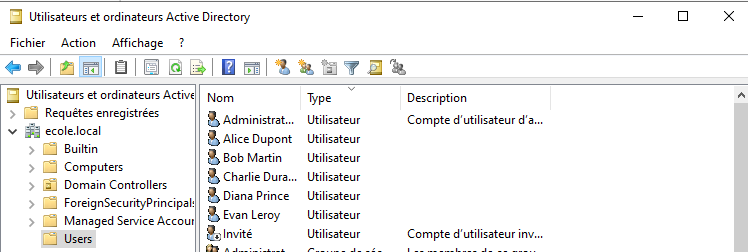
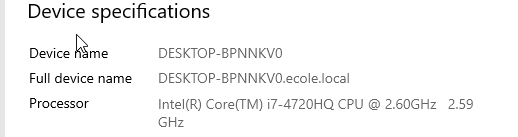
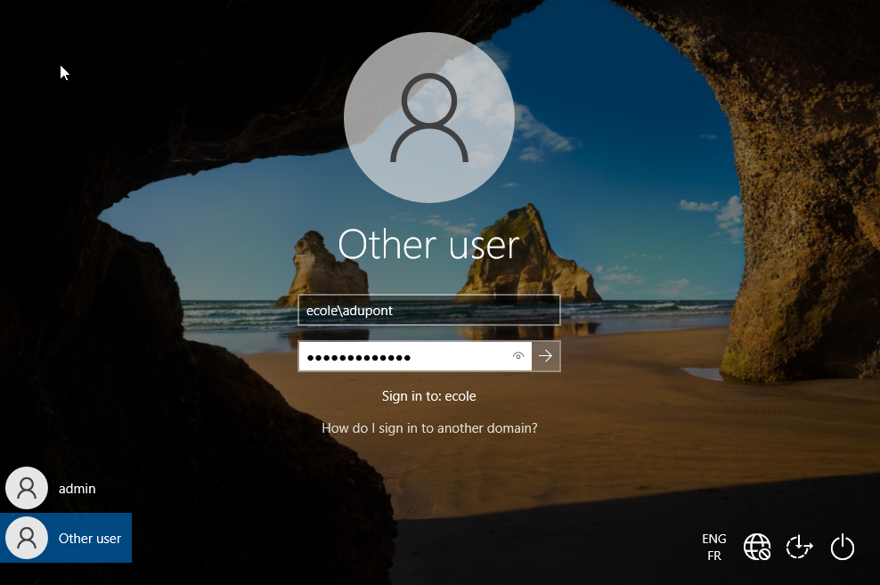
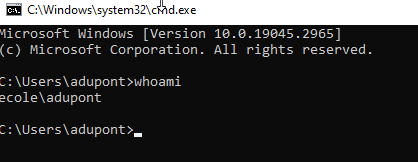
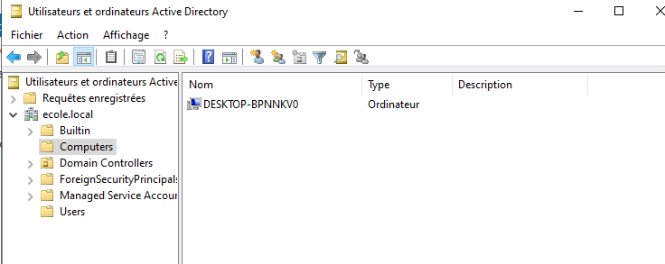

# 🏢 Projet 3 : Déploiement de Serveurs Windows (Active Directory)

Ce projet simule la mise en place du contrôleur de domaine (le "cerveau") d'une entreprise. Il a été réalisé dans un environnement virtualisé (VirtualBox) pour créer un réseau d'entreprise isolé et sécurisé.

## 🎯 Objectifs du projet
* Installer Windows Server 2022 et configurer son réseau (IP fixe et DNS).
* Installer et promouvoir le rôle **Active Directory Domain Services (AD DS)**.
* Créer une nouvelle forêt (domaine) nommée `ecole.local`.
* Automatiser la création de 5 utilisateurs avec **PowerShell**.
* Joindre un PC client Windows 10 au domaine et tester l'authentification.

## 🛠️ Environnement technique
* **Hyperviseur :** Oracle VirtualBox
* **Serveur :** Windows Server 2022 (Rôle AD DS & DNS)
* **Client :** Windows 10
* **Domaine :** `ecole.local`
* **Réseau :** Réseau Interne (`labo-ad`)
* **IP Serveur :** `192.168.2.10` (Passerelle & DNS)
* **IP Client :** `192.168.2.20`

## 👥 Utilisateurs créés via PowerShell
Les 5 utilisateurs suivants ont été créés en masse à l'aide de la commande `New-ADUser` (mot de passe standard : `P@ssw0rd2025!`) :
1. Alice Dupont (`adupont`)
2. Bob Martin (`bmartin`)
3. Charlie Durand (`cdurand`)
4. Diana Prince (`dprince`)
5. Evan Leroy (`eleroy`)

## 🧪 Tests et Validations (Preuves)

**1. Configuration IP du serveur (Adresse fixe)**

**2. Installation du rôle AD DS**

**3. Serveur promu Contrôleur de domaine (AD DS & DNS)**

**4. Création des utilisateurs en masse via PowerShell**

**5. Vérification des 5 utilisateurs dans l'Active Directory**

**6. Preuve de la jonction du PC Windows 10 au domaine**

**7. Écran de connexion de l'utilisateur du domaine**

**8. Commande `whoami` prouvant l'authentification par le serveur**

**9. Le PC client enregistré dans l'Active Directory (Dossier Computers)**

## 🏁 Récap' de ce que j'ai appris
* Administration d'un serveur Windows Server via le Gestionnaire de serveur.
* Configuration réseau avancée (IP statique, DNS) dans un environnement virtualisé.
* Déploiement et gestion d'Active Directory (AD DS).
* Automatisation de tâches répétitives avec PowerShell (`New-ADUser`).
* Jonction de client et gestion de l'authentification centralisée de domaine.
